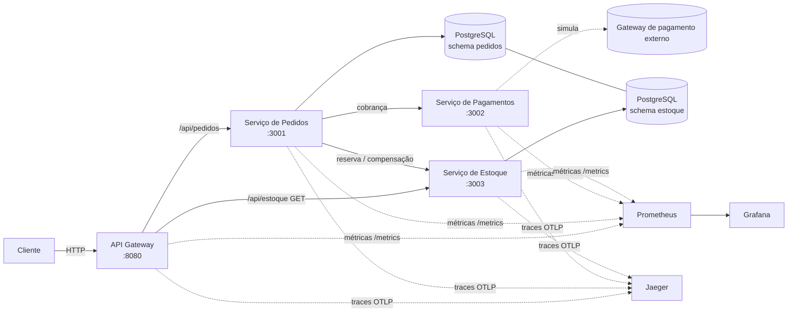

# Pedidos Veloz — Entrega contínua de microsserviços (Docker Compose → Kubernetes)

Proposta Cloud DevOps fim a fim para a plataforma de pedidos da **Loja Veloz**: desenvolvimento local padronizado
com Docker Compose, imagens enxutas e versionadas, Kubernetes com práticas de produção, pipeline de CI/CD,
observabilidade (métricas, logs e traces) e infraestrutura reproduzível com Terraform.

> 🎥 **Vídeo pitch (YouTube):** _cole aqui o link_

---

## 1. Arquitetura



| Serviço | Responsabilidade | Exposto ao público? |
|---|---|---|
| **gateway** | Ponto único de entrada, roteamento, timeout, `x-request-id` | Sim |
| **pedidos** | Cria/consulta pedidos e orquestra o fluxo (saga) | Não |
| **estoque** | Consulta, reserva e libera itens (transação atômica) | Somente leitura via gateway |
| **pagamentos** | Integração (simulada) com gateway de pagamento externo | Não |
| **postgres** | Persistência; um schema e um usuário por serviço (menor privilégio) | Não |

**Fluxo de um pedido:** `POST /api/pedidos` → pedido `PENDENTE` → reserva de estoque → cobrança →
`CONFIRMADO`. Se faltar estoque → `SEM_ESTOQUE` (409). Se o pagamento for recusado → o estoque reservado é
**liberado (compensação)** e o pedido fica `FALHA_PAGAMENTO` (402).

---

## 2. Estrutura do repositório

```
.
├── docker-compose.yml          # ambiente local completo (app + banco + observabilidade)
├── .env.example                # variáveis de ambiente (copie para .env)
├── Makefile                    # atalhos: up, down, test, smoke, kind-up...
├── services/
│   ├── gateway/ pedidos/ pagamentos/ estoque/   # cada um: src/, test/, Dockerfile, package.json
├── db/init/01-init.sh          # cria schemas, usuários por serviço e dados de exemplo
├── observability/              # prometheus.yml + Grafana (datasource e dashboard provisionados)
├── k8s/
│   ├── base/                   # Namespace, ConfigMaps, Postgres, Deployments, Services, HPA, PDB, NetworkPolicy, Ingress
│   ├── overlays/{local,producao}/   # tags/registry das imagens (kustomize)
│   └── observability/          # Jaeger + ServiceMonitor
├── terraform/                  # VPC + cluster EKS (esqueleto)
└── .github/workflows/ci-cd.yml # pipeline
```

---

## 3. Ambiente local (Docker Compose)

**Pré-requisitos:** Docker com Compose v2. (Node.js 22 só é necessário para rodar os testes fora do Docker.)

```bash
cp .env.example .env          # ajuste as senhas se quiser
docker compose up -d --build  # ← UM ÚNICO COMANDO sobe tudo
```

Ou simplesmente `make up`.

| O quê | URL |
|---|---|
| API (gateway) | http://localhost:8080 |
| Jaeger (traces) | http://localhost:16686 |
| Prometheus | http://localhost:9090 |
| Grafana (usuário `admin`, senha = `GRAFANA_ADMIN_PASSWORD`) | http://localhost:3000 |

### Experimente

```bash
# 1) Pedido com sucesso
curl -s -X POST localhost:8080/api/pedidos -H 'content-type: application/json' \
  -d '{"cliente":"Ana","metodo":"pix","itens":[{"sku":"CAM-001","quantidade":2,"preco":49.9}]}'

# 2) Sem estoque  -> 409 / SEM_ESTOQUE
curl -s -X POST localhost:8080/api/pedidos -H 'content-type: application/json' \
  -d '{"cliente":"Bia","itens":[{"sku":"MOC-003","quantidade":999,"preco":10}]}'

# 3) Pagamento recusado -> 402 / FALHA_PAGAMENTO (e o estoque é devolvido)
curl -s -X POST localhost:8080/api/pedidos -H 'content-type: application/json' \
  -d '{"cliente":"Caio","metodo":"cartao_recusado","itens":[{"sku":"TEN-002","quantidade":3,"preco":199}]}'

curl -s localhost:8080/api/estoque          # estoque atual
curl -s localhost:8080/api/pedidos          # pedidos
```

Depois abra o **Jaeger**, escolha o serviço `gateway` e veja o trace atravessando
`gateway → pedidos → estoque / pagamentos → PostgreSQL`. No **Grafana**, o dashboard *Loja Veloz – RED* mostra
taxa de requisições, erros, latência p95 e pedidos por status.

Para encerrar: `docker compose down` (use `-v` para apagar também os volumes/dados).

### Redes, volumes e variáveis

- **Redes:** `publica` (gateway e UIs), `backend` (serviço↔serviço) e `db` (**internal**: o banco não é acessível do host nem tem saída para a internet).
- **Volumes:** `pgdata`, `promdata`, `grafanadata`.
- **Variáveis:** todas em `.env` (ver `.env.example`); o Compose falha com mensagem clara se faltar uma senha obrigatória.

---

## 4. Testes

```bash
make test        # lint + testes dos 4 serviços (npm ci, npm run lint, npm test)
```

Testes unitários com o runner nativo do Node (`node --test`), sem dependências extras: validação de entrada,
fluxo de sucesso, falta de estoque, **compensação** quando o pagamento falha, falha de dependência (503),
proxy do gateway (502/405/404) e endpoints de saúde/métricas.

---

## 5. Conteinerização e versionamento

Cada serviço tem um `Dockerfile` **multi-stage** (`node:22-alpine`):

| Boa prática | Como foi aplicada |
|---|---|
| Imagem enxuta | Estágio `deps` instala só dependências de produção (`npm ci --omit=dev`); a imagem final copia apenas `node_modules`, `package.json` e `src` |
| Não rodar como root | `USER node` (uid 1000) |
| Cache de build | `COPY package*.json` antes do código + cache mount do npm; `.dockerignore` por serviço |
| Reprodutibilidade | `package-lock.json` + `npm ci` |
| Saúde | `HEALTHCHECK` chamando `/healthz` |
| Hardening em runtime | No Compose: `read_only`, `cap_drop: ALL`, `no-new-privileges` |
| Versionamento | Compose usa `loja-veloz/<svc>:${TAG}`; no CI as imagens recebem tags **imutáveis** `sha-<commit>`, `x.y.z` (tags `vX.Y.Z`) e `latest` (apenas em `main`) no **GHCR** |

---

## 6. Kubernetes — produção mínima

Manifests em `k8s/base` (aplicados com **kustomize**; `overlays/` define registry e tag das imagens).

| Requisito | Onde |
|---|---|
| Deployments e Services | `30-apps.yaml` |
| ConfigMaps | `10-config.yaml` (URLs, nível de log, endpoint OTLP, init do banco) |
| Secrets | `loja-veloz-secrets` — **não versionado**; ver `secrets.example.yaml` (criado pelo CI a partir dos GitHub Secrets) |
| Probes | `startupProbe` + `readinessProbe` (`/readyz`, valida o banco) + `livenessProbe` (`/healthz`) |
| Recursos | `requests` e `limits` de CPU/memória (necessários para o HPA) |
| Segurança | **Pod Security Admission `restricted`** no namespace; `runAsNonRoot`, `readOnlyRootFilesystem`, `drop ALL`, `seccomp RuntimeDefault`, `automountServiceAccountToken: false`; **NetworkPolicies** com *default deny* |
| Disponibilidade | `PodDisruptionBudget`, `topologySpreadConstraints`, `preStop` + graceful shutdown |
| Entrada | `Ingress` somente para o gateway |

### Rodando localmente com kind

```bash
make kind-up      # cria o cluster, constrói/carrega as imagens, cria o Secret e aplica o overlay local
kubectl -n loja-veloz get pods -w
kubectl -n loja-veloz port-forward svc/gateway 8080:80
curl localhost:8080/api/estoque
make kind-down
```

> O HPA exige o *metrics-server*; as NetworkPolicies exigem um CNI com suporte (Calico/Cilium). No kind padrão elas existem mas não são aplicadas.
> Para traces no cluster, aplique também `k8s/observability/jaeger.yaml`; para métricas, instale o `kube-prometheus-stack` e o `servicemonitor.yaml` (instruções no arquivo).

---

## 7. CI/CD (GitHub Actions)

Arquivo: `.github/workflows/ci-cd.yml`

```
push/PR ─► test (4 serviços em paralelo: lint, testes, npm audit)
        ─► validate (docker compose config, kustomize+kubeconform, terraform fmt/validate)
        ─► build (imagem → scan Trivy → push no GHCR com tag sha/semver)   [push só fora de PR]
        ─► deploy (ambiente "production" com aprovação manual → kubectl apply → rollout status → rollback automático se falhar)
```

**Configuração necessária** (Settings → Secrets and variables → Actions):

| Secret | Uso |
|---|---|
| `KUBE_CONFIG_B64` | kubeconfig do cluster em base64 (`base64 -w0 ~/.kube/config`) |
| `POSTGRES_PASSWORD`, `PEDIDOS_DB_PASSWORD`, `ESTOQUE_DB_PASSWORD` | viram o Secret `loja-veloz-secrets` no cluster |

- Crie o *Environment* `production` e marque **Required reviewers** para ter o *gate* de aprovação.
- `GITHUB_TOKEN` (automático) publica no GHCR; as permissões do workflow começam em `contents: read`.
- Para o cluster baixar imagens do GHCR, torne os pacotes públicos ou adicione um `imagePullSecret`.
- Em produção madura, prefira autenticação **OIDC** com a nuvem em vez de kubeconfig estático, e fixe actions por *commit SHA*.

---

## 8. Estratégia de deploy: **Rolling Update**

`maxUnavailable: 0` + `maxSurge: 1` + `readinessProbe` + `minReadySeconds` + `preStop`:
o Kubernetes sobe um pod novo, espera ficar *Ready*, só então remove um antigo — **sem perda de capacidade e sem indisponibilidade** durante o deploy, que era a dor principal da Loja Veloz.
Se o rollout travar, o pipeline executa `kubectl rollout undo`.

| Estratégia | Por que (não) |
|---|---|
| **Rolling** ✅ | Nativa, sem custo extra de infraestrutura, resolve o problema atual e é simples de operar para o prazo de 4 semanas |
| Blue/Green | Rollback instantâneo, porém dobra a capacidade durante o deploy e exige tratar compatibilidade de schema do banco |
| Canary | Menor risco para mudanças de alto impacto; requer *traffic splitting* (Argo Rollouts, Istio/Linkerd ou Gateway API). É a **evolução natural** após a campanha |

---

## 9. Escalabilidade

- **HPA v2** (`40-hpa.yaml`) em todos os serviços: alvo de **70% de CPU**, mínimo 2 réplicas (alta disponibilidade), máximo 10 (gateway/pedidos) ou 6.
  `behavior`: *scale-up* imediato (picos de campanha) e *scale-down* lento (janela de 300 s) para evitar oscilação.
- Serviços **stateless** (12-Factor): estado fica no PostgreSQL, então qualquer réplica atende qualquer requisição.
- **VPA** não foi aplicado aos Deployments porque conflitaria com o HPA no mesmo recurso (CPU); é recomendado em modo `recommendation` para calibrar `requests/limits` e, no futuro, para o banco.
- Nós: no Terraform, o node group tem `min/max`; em produção use Cluster Autoscaler ou Karpenter para escalar os nós junto com os pods.

---

## 10. Observabilidade

| Pilar | Implementação |
|---|---|
| **Métricas** | `prom-client` em `/metrics`: histograma `http_request_duration_seconds` (método de **RED**: Rate, Errors, Duration) + métricas de runtime + métricas de negócio (`pedidos_total{status}`, `estoque_reservas_total`, `pagamentos_total`). Prometheus + dashboard Grafana provisionado |
| **Logs** | JSON estruturado em *stdout* (12-Factor), com `service`, `level` e **`trace_id`/`span_id`** para correlacionar log ↔ trace. Em produção: coletor (Fluent Bit/Promtail) → Loki/ELK |
| **Traces** | **OpenTelemetry** (instrumentação de HTTP, Express, `fetch` e `pg`) exportando via OTLP para o **Jaeger**; o header `traceparent` é propagado entre serviços. Desativável removendo `OTEL_EXPORTER_OTLP_ENDPOINT` |
| Saúde | `/healthz` (liveness) e `/readyz` (readiness) |

**Alertas sugeridos:** taxa de 5xx > 2% por 5 min; p95 > 1 s por 10 min; pods *NotReady*; HPA no máximo por > 15 min; fila de pagamentos recusados anormal.

**Service mesh (Istio/Linkerd):** não foi incluído no MVP para limitar a complexidade operacional. Traria mTLS automático, *traffic splitting* para canary e telemetria sem alterar código; é o passo seguinte caso o número de serviços cresça.

---

## 11. Segurança (resumo)

- Imagens: multi-stage, não-root, dependências mínimas, **scan Trivy** no pipeline e `npm audit`.
- Credenciais: nunca no Git — `.env` (local), Secrets do Kubernetes (criados pelo CI a partir de GitHub Secrets) e, recomendado em produção, External Secrets/cofre na nuvem.
- Banco: **usuário e schema por serviço** (menor privilégio), rede `internal` no Compose e NetworkPolicy no cluster.
- Cluster: Pod Security Admission `restricted`, *default deny* de rede, sem *service account token*, filesystem somente leitura.
- Superfície pública mínima: apenas o gateway; **pagamentos não é exposto** e estoque é somente leitura.

---

## 12. Infraestrutura como código (Terraform)

`terraform/` contém um **esqueleto** para AWS: VPC (3 AZs, sub-redes públicas/privadas, NAT) e cluster **EKS** gerenciado
com node group, usando os módulos oficiais da comunidade (`terraform-aws-modules`).

```bash
cd terraform
cp terraform.tfvars.example terraform.tfvars
terraform init && terraform plan
# terraform apply   # ⚠️ cria recursos que geram custo na AWS
$(terraform output -raw configure_kubectl)
```

Boas práticas incluídas: variáveis com validação, *default tags*, versões fixadas, `single_nat_gateway` apenas fora de produção e bloco de **backend remoto S3 com lock** pronto para ativar (estado nunca no Git).
O pipeline roda `terraform fmt -check` e `terraform validate` a cada mudança.

---

## 13. Decisões e limitações conhecidas

| Decisão | Justificativa / limitação |
|---|---|
| **Sem mensageria no MVP** | Comunicação síncrona HTTP + saga orquestrada com compensação é suficiente para o volume do MVP e mais simples de operar. O evento `PedidoCriado` já é emitido em log; migrar para RabbitMQ/Kafka (outbox pattern) é a evolução para desacoplar e absorver picos |
| **Um PostgreSQL, schemas separados** | Isola dados por serviço com custo/complexidade menores. Em produção: banco gerenciado, réplicas e backup |
| **Postgres no cluster (StatefulSet)** | Didático. Prefira RDS/Cloud SQL ou operador (CloudNativePG) |
| **Migrações via script de init** | Roda só na 1ª inicialização do volume. Evoluir para ferramenta de migração (Flyway, node-pg-migrate) executada como *Job* no pipeline |
| **Jaeger em memória** | Suficiente para demonstração; em produção usar armazenamento persistente e *sampling* |
| **Código de infra compartilhado duplicado** (`logger`, `metrics`, `tracing`) | Mantém cada serviço independente para o exercício; em um monorepo maior, extrair uma biblioteca interna |
| **Pagamento simulado** | Substitui a integração externa por latência/recusa configuráveis (`PAGAMENTO_LATENCIA_MS`, `PAGAMENTO_LIMITE`) |

---

## 14. Referências (fontes primárias)

- Kubernetes — Deployments, Services, ConfigMaps/Secrets, probes, HPA, Pod Security Standards: https://kubernetes.io/docs/
- Docker — Dockerfile, multi-stage builds, Compose: https://docs.docker.com/
- The Twelve-Factor App: https://12factor.net/
- Terraform — módulos, variáveis, state: https://developer.hashicorp.com/terraform/docs
- GitHub Actions: https://docs.github.com/actions
- OpenTelemetry (JS) e Jaeger: https://opentelemetry.io/docs/languages/js/ · https://www.jaegertracing.io/docs/
- Istio (service mesh): https://istio.io/latest/docs/

_Case/arquitetura de referência pesquisado: ver relatório técnico._
